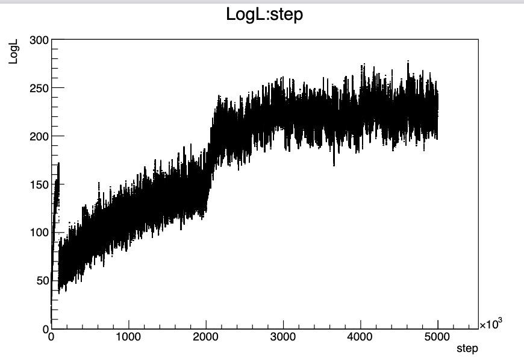
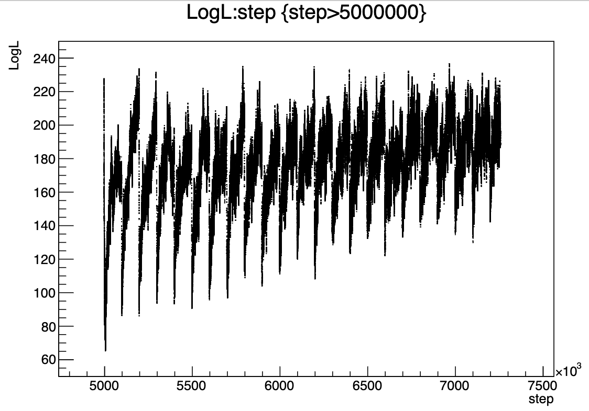

# Adaptive MCMC

The adaptive sampler is implemented by {cpp:class}`AdaptiveMCMCHandler`.
## Overview

Manually tuning MCMC is
1. Tedious
2. Hard

Thankfully, we can automate this process! Adaptive MCMC (AMCMC) "learns" the optimal step size required to efficiently explore the space. In the case of a Gaussian proposal function target a roughly Gaussian parameter this turns out to be the covariance of the posterior multiplied by a constant scaling factor of $2.38^{2}/n_{pars}$. Since we can't know the covariance of the posterior before running a fit, we instead need to use the covariance of the chain we're currently running. We can then update our proposal function every few steps and hope this converges to the "true" posterior covariance.

## Robbins-Monro Adaption
In many spaces $2.38^{2}/n_{\mathrm{pars}}$ is not actually the optimal scaling
factor. Instead we can use a stochastic process called Robbins-Monro to
increase or decrease this scale dynamically and get the chain to have a
particular acceptance rate instead. Typically in MCMC this "optimal" rate is
23.4% (...in some sense) so we target this! In testing this has been shown to
provide a 25%-300% improvement in efficiency (integrated auto-correlation) over
regular adaptive MCMC with a fixed scale.

## Troubleshooting
### HELP! My posteriors are miles away where I expect them to be!!!!
A few easy checks first
1. Are your traces looking sensible?
2. Are your autocorrelations looking sensible?

If it looks like the step sizes are WAY too big, you might have a multi-modal parameter involved (usually $\Delta m^{2}_{32}$). If that's the case, simply run a fit with all jumps switched off and then use that matrix as your proposal for all future chains.

If you have really good traces but bad auto-correlations, it might simply be the case that the adaptive process hasn't finished. A tell tale sign of this is the LogL vs step plot "jumping" to a different LLH value far from your current one when you finish updating the adaptive process. Typically this happens when you're updating a large (>300 parameter) matrix with lots of correlations involved. Simply keep running the adaptive process for a few million more steps and waiting until there is a smooth transition between LLH and in the adaptive vs non-adaptive phases.

### When does it Work?
Adaptive MCMC works really well when all your parameters are Gaussian! This is typically the case for ND-only fits and most cross-section/flux parameters. As a rule of thumb it's best to start throwing from your covariance matrix about 1000 - 10,000 steps into running your fit. You can see the effects of changing the adaption starting step as well as how well tuned the initial step sizes here:


*MCMC traces for chains with manual tuning (top), adaption applied from the first step (middle) and adaption applied from step 10,000. The chain with adaption from 10,000 shows the best fit with the lowest auto-correlation and a trace that rapidly improves before stabilising.*

In order to ensure a "valid" fit, adaption should be stopped at some point! You can pick this either totally arbitrarily or by looking the MCMC trace. If it seems like the trace has stopped improving for ~100,000 steps or so then you're safe to assume the throw matrix has more or less converged and you can run the fit with it switched off.

### How Do I Know It's Worked?
As with all MCMC, the first step is to check your traces and auto-correlations. For AMCMC you expect the trace to get increasingly good as the chain goes on! Auto-correlations should be checked for a chain post-adaption since checking this with adapting steps can lead to some false-positive results simply because the chain is not ergodic. Additionally, for long Asimov chains, one can look at the posteriors and check that they seem sensible and converge to the correct values.

### When Does This Fail?
So far it seems that AMCMC fails for multi-modal and cyclical parameters i.e. oscillations (and anything correlated with them like detector parameters). This can result in chains that converge to entirely incorrect results as in the following figure.


*MCMC fit with adaption switched off for all parameters (blue), non-oscillation parameters (green) and all parameters (red). One can see that they converge to totally different values.*

Adaptive MCMC can also run into problems with highly correlated parameters. This can be partially avoided by defining the highly correlated space as a separate "block". This separates your throw matrix into several independent block matrices, with the correlated parts being separate to the less correlated parts. One example of this is with cross-section and flux parameters in T2K.

## FAQ
### What values should I set the adaptive settings to?
My typical recommendation is:
1. Run a quick test chain without adaption + see how well tuned the chain is. Adaption requires some accepted steps as well so check that the chain accepts anything. Getting accepted steps can be as simple as decreasing your global step scale.
2. If you've got an "okay" looking chain with a short burn-in + it needs a little bit of tweaking you can start adaption a bit late. I've found starting updates at step 5000 + throws at step 10,000 with an update step of 1000 works pretty well here.
3. If your chain is awful then I'd recommend two things
   1. If the acceptance rate is ~0 do some manual step size tuning.
   2. If the acceptance rate is low but >1% then start adaption early + let it adapt for a long time. Robbins-Monro will also help here
4. Stopping adaption is a bit of a fine art. Adaption can be very slow so adapting for too long is rarely an issue. A simple metric you can check for this is the log-likelihood vs step. This can be drawn quickly via the root CLI with
```cpp
$ root -l -b <path/to/my/file.root>
$ posteriors->Draw("logL:step", "", "l")
$ c1->Print("logl_check.png")
```
If this has plateaued you've probably done enough adaption!

### My matrix cannot be Cholesky decomposed
If this happens you've simply not accepted enough steps. Set the gap between StartUpdate and StartThrow to be even larger

### My chain suddenly gets worse when adaption stops
* Try plotting the log-likelihood vs step plot.
If the plot you've got looks something like this:



you simply need to adapt for longer!

### I've plotted my Likelihood-trace it looks like a saw-tooth


This is caused by over-zealous use of Robbins-Monro's reset functionality. Typically we want to reset maybe once or twice to ensure the process is stable + not too badly affected by burn-in.

### Additional Reading
For more information on adaptive MCMC in MaCh3: https://etheses.whiterose.ac.uk/id/eprint/35901/

For more information about adaptive MCMC in general: http://www.probability.ca/jeff/ftpdir/adaptex.pdf

For more info on Robbins-Monro in MCMC: https://arxiv.org/abs/1006.3690

Useful Video Lecture: https://www.youtube.com/watch?v=DwE2-YMQR5Y
