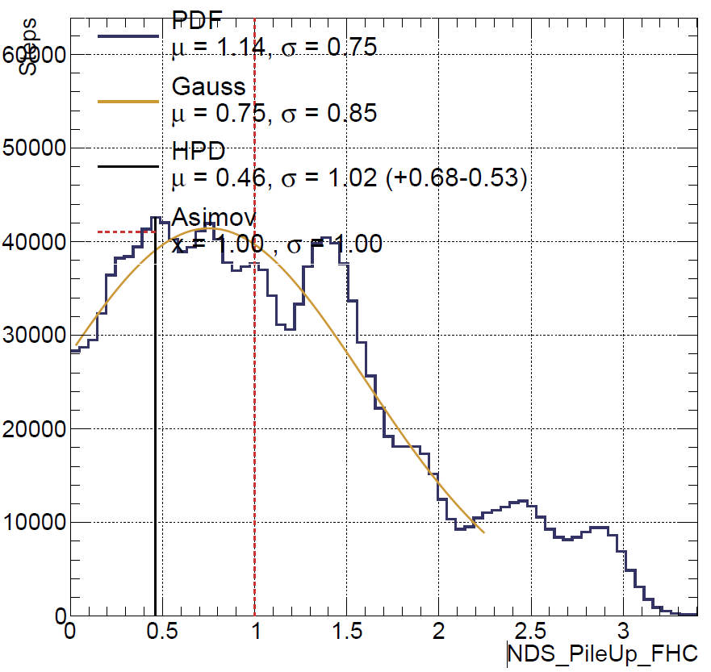
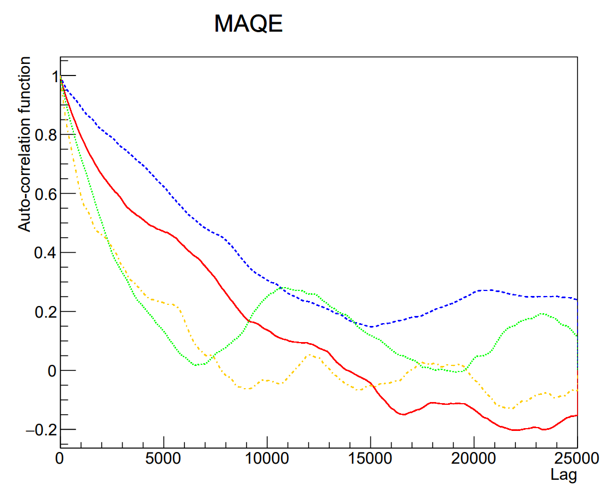
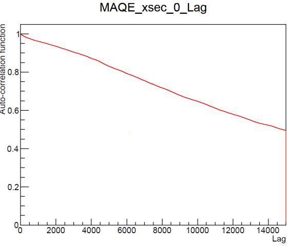
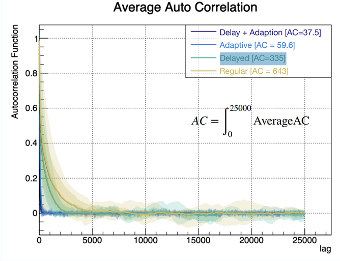
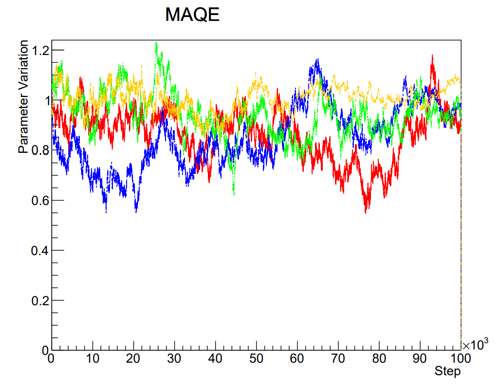
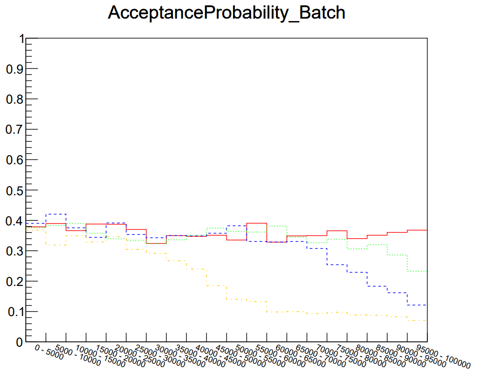
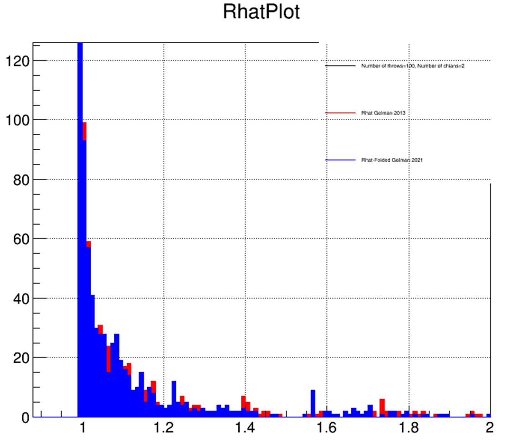
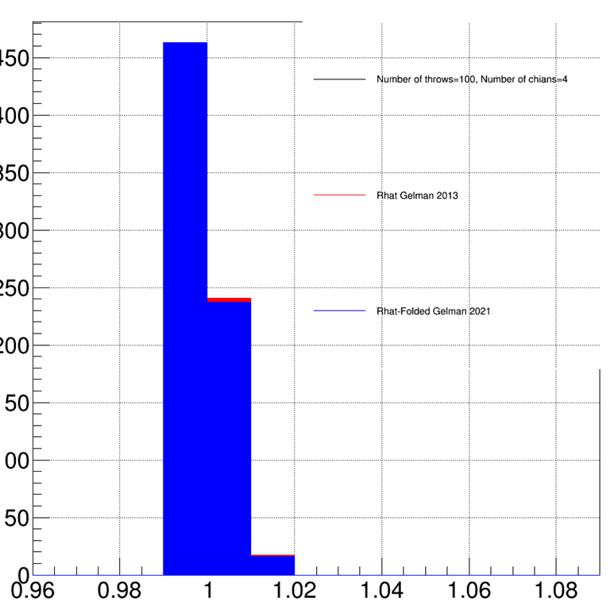
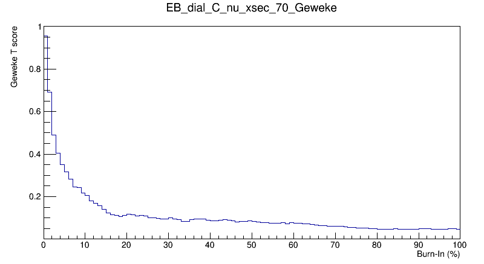

# MCMC Convergence

## What is step-size tuning, and why is it important?

Step-size tuning affects the efficiency of samplers such as
{cpp:class}`MR2T2`; the {cpp:class}`RHatCalculator` can help assess convergence.
It is good practice to run an MCMC diagnostic before looking at posterior distributions, although in most cases you will stumble on the need to diagnose after checking posteriors. If your posterior looks like this, either you do have not enough steps or wrongly tune the chain.  

Before discussing step size tuning, first we need to understand how a step is proposed.
* Gaussian throw - random number drawn from the Gauss distribution starting at the previous step multiplied with a spread equal to parameter error.
* Correlated throw - the proposed step for two correlated parameters should be more likely to change direction in the same way; hence we include correlation using the Cholesky matrix.
* Individual step scale - user selected value for each parameter by a default =1, by step size tuning in most cases we mean modifying this value.
* Global step scale - user selected value same cor all parameters in a given covariance class. For example, the value is the same for all xsec-based parameters.

## MCMC diagnostic
There are several plots worth studying for MCMC diagnostic you can find the executables which produce them in the `Diagnostics` folder.
### Autocorrelations
We can study chain autocorrelation, which tells us how many particular steps are correlated. To test it, we introduce a variable _Lag(n)= corr(Xi, Xi−n)_ which tells us how much correlated are steps that are _n_ steps apart, where _i_ is the maximal considered distanced, here _i = 25000_. Fig. shows autocorrelations for studied chains since we want our steps to be more random, and less correlated to quickly converge. The rule of thumb is for autocorrelation to drop below 0.2 for _Lag(n = 10000)_. This isn’t a strict criterion, so if sometimes autocorrelations drop slightly slower than the blue line in our Figure, it’s not a problem.  

Example of well-tuned step scale (colours represent chains which have different starting positions)  

If your autocorrelation looks like this, though, you really should increase step size. One exception would be parameter which has no effect. Imagine you run ND only fit, but the parameter affects FD only. Then it is expected autocorrelation to look badly.  

Sometimes it is difficult to go gauge which configuration is better with order of hundreds of parameters. Therefore, it can be useful to look average autocorrelations as in plot below then one can clearly see which has the lowest autocorrelations:

### Autocorrelations vs Acceptance
In many cases (though not always), reducing autocorrelations can also decrease the acceptance rate—that is, how often a proposed step is accepted. While very low autocorrelations are generally desirable, achieving them at the cost of an acceptance rate of only a few percents is usually a sign of problems with the tuning. As a rule of thumb, we should aim for an acceptance rate between 10% and 30%, which provides a good balance between efficient exploration and stable sampling.

### Trace
Fig. shows the trace, which is the value of a chosen parameter at each step. It can be seen that at first, the chains have different traces but after a thousand steps, they start to stabilise and oscillates around a very similar value, indicating that the chain converged, and a stationary state was achieved.  

### Acceptance Probability Batch
Fig. shows a mean value of acceptance probability (_A(θ',θ)_) in an interval of
5k steps (batched mean). This quantity is quite high at the beginning, indicating the chain didn’t
converge. When the chain gets close to the stationary state, it starts to stabilise. Orange
stabilised the fastest, while blue and green are slowly catching up, but the red didn’t converge yet.  

### R Hat
Usually, we run several chains which are later combined. There is a danger that not all chains will converge, then using them will bias results. R hat is meant to estimate whether chains converged successfully or not. According to Gelman, you should calculate R hat for at least 4 chains and if R hat > 1.1 then it might indicate wrong chains convergence. Below you can find an example of chains which wrongly converged and one which successfully

Chains converged to different values

Successfully converged chains

### Geweke
Geweke Diagnostic helps to define what burn it should it be. You should select burn-in around 15% in this case, as this is where distribution stabilises.

## Global Step Scale
According to **[1]** (Section 3.2.1), the global step size should be equal to 2.38^2/N_params. Keep in mind this refers to the global step scale for a given covariance object like xsec covariance or detector covariance.

## Manual Tuning
This procedure is very tedious and requires intuition of how a given parameter behaves. It is a bit of dark magic however skilled users should be able to tune it relatively fast compared with the non-skilled user. The process is as follows, you run the chain, run the `diagnostic` executable look at plots adjust the step scale then run again fit and the process repeats. Each time you should look at autocorrelations, traces, etc. (see discussion above). Another important trick is not to run full fit. Instead of running 10M chain, you might run 200k. Number of steps depends on number of parameters and _Lag(n = ?)_ you are interested in.  

There are a few things you should be aware of when tuning:
* Parameters with a broad range may have a higher step scale, while those with a narrow should have smaller ones to reduce the probability of going out of bounds.
* Highly correlated should have a similar step-scale, for edge cases like ~100% step scale should be identical!
* Autocorrelations should drop below 0.2 for _Lag(n = 10000)_ (this is rule of thumb not law). If it drops immediately, then the step scale is too big.
* Study trace, if is converging, exploring phase space fast enough. Exploring too fast is wrong.
* Study acceptance probability. If every step is accepted then the scale is too small, while if barely any step is getting accepted you might consider decreasing the step scale.
* Doing LLH scan and assigning a step scale based on such a result is also a good idea.

The last point is that data fit may require a different tuning than the Asimov fit. Still, if you tune for Asimov it should be easy to re-tune for a data fit.

## LLH Scan Step Scale Tuning
* To avoid having to hand tune a large number of parameters where correlations will impact the tuning of one another, a good first step is using the LLH scan step scale. It considers the LLH distribution, assuming it is Gaussian, and assigns the step scale for the parameter as 2.38/sqrt(N_params*LLH_value), where the LLH_value is the maximum value in the distribution.
* The code also ensures that any correlated parameters (where correlated is defined as > 0.3) have the same step scale assigned, by taking the average of the LLH results for each case.
* It is also possible to consider the LLH step scale for only a set combination of parameters, but it is important to take care that any changes to some step scales, do not effect the convergence of other parameters, especially those that are correlated to the newly tuned parameters.

## References
[1] https://asp-eurasipjournals.springeropen.com/track/pdf/10.1186/s13634-020-00675-6.pdf   
