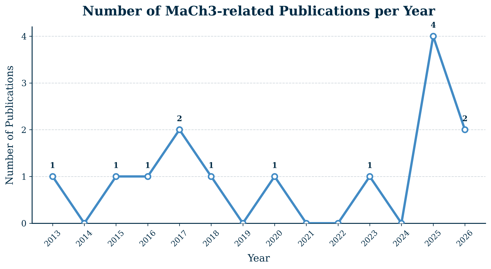
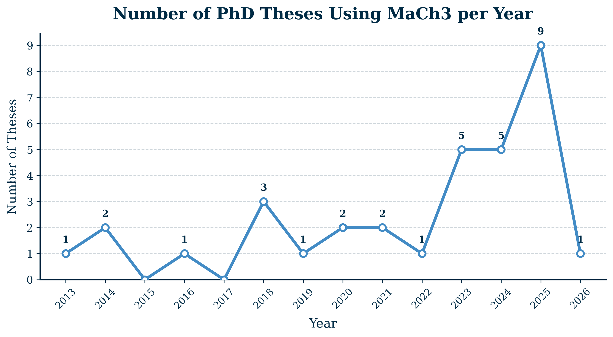

# Results and Publications
> **Last updated:** 15 September 2026

## Publications using MaCh3
* The DUNE Collaboration. A Bayesian approach to the long-baseline neutrino oscillation sensitivity of DUNE. *arXiv:2608.04059* (**2026**). [https://doi.org/10.48550/arXiv.2608.04059](https://doi.org/10.48550/arXiv.2608.04059)
* The T2K Collaboration. Constraining Neutrino Interaction Uncertainties for Neutrino Oscillation Measurements at the T2K Experiment. arXiv:2606.14015 (**2026**) [https://doi.org/10.48550/arXiv.2606.14015](https://doi.org/10.48550/arXiv.2606.14015)
* The T2K Collaboration. Results from the T2K Experiment on Neutrino Mixing Including a New Far Detector μ-like Sample. *Phys. Rev. Lett., 135(26)*, 261801 (**2025**). [https://doi.org/10.1103/gh5j-5cwv](https://doi.org/10.1103/gh5j-5cwv)
* The T2K Collaboration. Testing T2K’s Bayesian constraints with priors in alternate parameterisations. *Eur. Phys. J. C, 85(12), 1414* (**2025**). [https://doi.org/10.1140/epjc/s10052-025-14836-0](https://doi.org/10.1140/epjc/s10052-025-14836-0)
* The T2K and NOvA Collaborations. Joint neutrino oscillation analysis from the T2K and NOvA experiments. *Nature 646, 818-824* (**2025**). [https://doi.org/10.1038/s41586-025-09599-3](https://doi.org/10.1038/s41586-025-09599-3)
* The T2K and Super-Kamiokande Collaborations. First joint oscillation analysis of Super-Kamiokande atmospheric and T2K accelerator neutrino data. Phys. *Rev. Lett., 134(1), 011801* (**2025**). [https://doi.org/10.1103/PhysRevLett.134.011801](https://doi.org/10.1103/PhysRevLett.134.011801)
* The T2K Collaboration. Measurements of neutrino oscillation parameters from the T2K experiment using 3.6×10²¹ protons on target. *Eur. Phys. J. C, 83(9), 782* (**2023**). [https://doi.org/10.1140/epjc/s10052-023-11819-x](https://doi.org/10.1140/epjc/s10052-023-11819-x)
* The T2K Collaboration. Constraint on the matter–antimatter symmetry-violating phase in neutrino oscillations. *Nature 580, 339–344* (**2020**). [https://doi.org/10.1038/s41586-020-2177-0](https://www.nature.com/articles/s41586-020-2177-0)
* The T2K Collaboration. Search for CP violation in neutrino and antineutrino oscillations by the T2K experiment with 2.2×10²¹ protons on target. Phys. *Rev. Lett., 121(17), 171802* (**2018**). [https://doi.org/10.1103/PhysRevLett.121.171802](https://doi.org/10.1103/PhysRevLett.121.171802)
* The T2K Collaboration. Measurement of neutrino and antineutrino oscillations by the T2K experiment including a new additional sample of νₑ interactions at the far detector. *Phys. Rev. D, 96(9), 092006* (**2017**). [https://doi.org/10.1103/PhysRevD.96.092006](https://doi.org/10.1103/PhysRevD.96.092006)
* The T2K Collaboration. Combined analysis of neutrino and antineutrino oscillations at T2K. *Phys. Rev. Lett., 118(15), 151801* (**2017**). [https://doi.org/10.1103/PhysRevLett.118.151801](https://doi.org/10.1103/PhysRevLett.118.151801)
* The T2K Collaboration. Measurement of muon antineutrino oscillations with an accelerator-produced off-axis beam. *Phys. Rev. Lett., 116(18), 181801* (**2016**). [https://doi.org/10.1103/PhysRevLett.116.181801](https://doi.org/10.1103/PhysRevLett.116.181801)
* The T2K Collaboration. Measurements of neutrino oscillation in appearance and disappearance channels by the T2K experiment with 6.6×10²⁰ protons on target. *Phys. Rev. D, 91(7), 072010* (**2015**). [https://doi.org/10.1103/PhysRevD.91.072010](https://doi.org/10.1103/PhysRevD.91.072010)
* The T2K Collaboration. Measurement of Neutrino Oscillation Parameters from Muon Neutrino Disappearance with an Off-axis BeamMeasurement of Neutrino Oscillation Parameters from Muon Neutrino Disappearance with an Off-axis Beam. *Phys. Rev. Lett. 111, 211803* (**2013**). [https://doi.org/10.1103/PhysRevLett.111.211803](https://journals.aps.org/prl/abstract/10.1103/PhysRevLett.111.211803)

## Theses using MaCh3
* Naseem Khan, [Prototyping of and sensitivity studies for a gaseous argon near detector for the deep underground neutrino experiment](https://spiral.imperial.ac.uk/entities/publication/1115681d-77aa-4014-b1eb-d947ab7d4388), (**2026**)
* Marcelo Ismerio Moreira Leite de Oliveira, [Atmospheric Neutrino Analyses in the Deep Underground Neutrino Experiment](https://drive.google.com/file/d/12jjlfYNOltm5otFxQsmHyD999tSRt0QQ/view?usp=sharing), (**2025**)
* Mo Jia, [Upgrading the Joint Neutrino Oscillation Analysis of T2K and Super-Kamiokande Experiments via Surfing in a High-dimensional Detector Uncertainty Space](https://www.t2k.org/docs/thesis/159), (**2025**)
* Michael Reh, [Analysis of Detector Systematic Uncertainties Using Atmospheric Neutrinos in a Novel Markov Chain Monte Carlo Framework for T2K Data Runs 1-11](https://www.t2k.org/docs/thesis/157), (**2025**)
* Liban Warsame, [First Bayesian neutrino oscillation analysis of DUNE](https://spiral.imperial.ac.uk/entities/publication/e4e329ce-512d-4ed2-8bba-0e978c7c41ee), (**2025**)
* Tailin Zhu, [Measurement of neutrino oscillation parameters at T2K using new neutral current pion samples and probing future sensitivities with Hyper-Kamiokande](https://spiral.imperial.ac.uk/entities/publication/15ebfee9-b26d-4795-9d37-22bc78e3616e), (**2025**)
* Menai Lamers James, [Development of a boosted decision tree antineutrino photon near detector sample for T2K, and design of the Hyper-Kamiokande outer detector and DAQ](https://eprints.lancs.ac.uk/id/eprint/222638/), (**2025**)
* Andres Lopez Moreno, [Reparametrisations of the leptonic mixing matrix for neutrino oscillation analysis in the T2K experiment](https://www.t2k.org/docs/thesis/155), (**2025**)
* Henry Wallace, [Analysis of Neutrino Oscillations at Current and Future Accelerator Neutrino Experiments](https://etheses.whiterose.ac.uk/id/eprint/35901/1/henry_wallace_thesis_corrected.pdf), (**2025**)
* Ewan Miller, [Constraining the Flux and Cross Section Uncertainties for the T2K Experiment Using ND280 Data](https://www.t2k.org/docs/thesis/152), (**2025**)
* Junjie Jiang, First Bayesian Results of a Joint Neutrino Oscillation Analysis between T2K Beam Neutrinos and Super-Kamiokande Atmospheric Neutrinos, (**2024**)
* Thomas Holvey, [New measurements of neutrino oscillation parameters and development of novel interaction uncertainties at current and future long-baseline experiments](https://ora.ox.ac.uk/objects/uuid:ad8add63-ddf9-4b4b-8cd1-cbe7bc4f4958), (**2024**)
* Yashwanth S Prabhu, [Expanded νe CC1π+ sample selection and improved systematic treatments for neutrino oscillation parameter determination with T2K data](https://bip.ncbj.gov.pl/artykul/89/116/postepowanie-w-sprawie-nadania-stopnia-doktora-mgr-yashwanth-sanjeev-prabhu), (**2024**)
* Alex Carter, [Constraining systematic uncertainties using T2K Near Detector with X and Y FGD2 scintillator layers information in Markov chain Monte Carlo framework](https://pure.royalholloway.ac.uk/en/publications/constraining-systematic-uncertainties-using-t2k-near-detector-wit/), (**2024**)
* Dan Martin, [Neutrino oscillation analysis using T2K data with additional single ring NCπ⁰ samples](https://spiral.imperial.ac.uk/entities/publication/007ce44e-ba1e-41cd-a487-071599a012b1) (**2024**)
* Nauman Akhlaq, [Developing the T2K Neutrino Oscillation Analysis by Using Pion Samples at the Near Detector](https://www.t2k.org/docs/thesis/135), (**2023**)
* Evan Arthur Gerald Goodman, [Combining T2K With Other Experiments to Better
Constrain Oscillation Parameters](https://theses.gla.ac.uk/84120/), (**2023**)
* Kamil Skwarczynski, [Constraining neutrino cross-section and flux models using T2K Near Detector with proton information in Markov chain Monte Carlo framework](https://bip.ncbj.gov.pl/artykul/89/77/postepowanie-w-sprawie-nadania-stopnia-doktora-mgr-kamil-skwarczynski-28-06-2023-r), (**2023**)
* Chloë Naseby, [Understanding the impact of an expanded neutral current pion production model on long-baseline oscillation analyses at T2K](https://spiral.imperial.ac.uk/entities/publication/69ae5733-cd7e-4b27-aabb-f161a93c9163), (**2023**)
* Ed Atkin, [Neutrino Oscillation Analysis at the T2K experiment including studies of new uncertainties on interactions involving additional final state hadrons](https://spiral.imperial.ac.uk/entities/publication/c37e38de-04a3-443c-893f-6efb4e7c716e), (**2023**)
* Dan Barrow, [The sensitivity to oscillation parameters from a simultaneous beam and atmospheric neutrino analysis that combines the T2K and SK experiments](https://ora.ox.ac.uk/objects/uuid:140699cd-b197-4343-9f9a-51b2ae115f14), (**2022**)
* Artur Sztuc, [Standard and non-standard neutrino-antineutrino oscillation analyses and event reconstruction studies using Markov chain Monte Carlo methods at T2K](https://spiral.imperial.ac.uk/entities/publication/62532ca8-60b8-4391-8e50-ef746a799ed7), (**2021**)
* Kevin Wood, Measurement of Neutrino Oscillation Parameters with T2K Data Corresponding to 3.6 × 10^21 Protons on Target Using a Bayesian Framework, (**2021**)
* Will Parker, [Constraining Systematic Uncertainties at T2K using Near Detector Data](https://pure.royalholloway.ac.uk/en/publications/constraining-systematic-uncertainties-at-t2k-using-near-detector-/), (**2020**)
* Tomoyo Yoshida, [A study of single charged-pion production events at Super-Kamiokande induced by charged-current interaction of T2K-beam muon neutrinos](https://www.t2k.org/docs/thesis/111), (**2020**)
* Clarence Wret, [Minimising Systematic Uncertainties in the T2K Experiment Using Near-Detector and External Data](https://spiral.imperial.ac.uk/entities/publication/e3674b91-ec6d-4d96-be0d-33b39457c436), (**2019**)
* Xiaoyue Li, [A Joint Analysis of T2K Beam Neutrino and Super-Kamiokande Sub-GeV Atmospheric Neutrino Data](https://www.stonybrook.edu/commcms/grad-physics-astronomy/_theses/li-xiaoyue-august-2018.pdf), (**2018**)
* Leïla Haegel, [Measurement Of Neutrino Oscillation Parameters Using Neutrino And Antineutrino Data Of The T2K Experiment](https://www.t2k.org/docs/thesis/087), (**2018**)
* Elder Pinzon, [Measurement of Pion-Carbon Cross Sections at DUET and Measurement of Neutrino Oscillation Parameters at the T2K Experiment](https://yorkspace.library.yorku.ca/items/e4fdb6a4-924d-4216-bbce-e80941ec031f), (**2018**)
* Kirsty Duffy, [Measurement of the neutrino oscillation parameters sin2θ23, ∆m232, sin2θ13, and δCP in neutrino and antineutrino oscillation at T2K](https://ora.ox.ac.uk/objects/uuid:4485185d-3f72-49d0-866c-af2bab55d916), (**2016**)
* Patrick de Perio, [Joint Three-Flavour Oscillation Analysis of Numu Disappearance and Nue Appearance in the T2K Neutrino Beam](https://www.t2k.org/docs/thesis/046), (**2014**)
* Richard Calland, [A 3 flavour joint near and far detector neutrino oscillation analysis at T2K](https://livrepository.liverpool.ac.uk/2009123/), (**2014**)
* Casey Bojechko, [Simultaneous Analysis of Near and Far Detector Samples of the T2K Experiment to Measure Muon Neutrino Disappearance](https://www.t2k.org/docs/thesis/035/cb_phd), (**2013**)

<!--
## Conference talks using MaCh3
* Kamil Skwarczynski, High dimensional fitting tools for neutrino oscillation and cross section analyses, [EDSU-Tools], (**2024**)  (https://indico.cern.ch/event/1267450/contributions/5887058/)
-->
