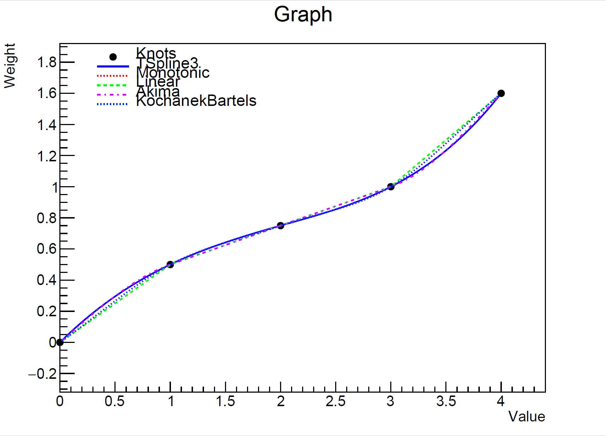
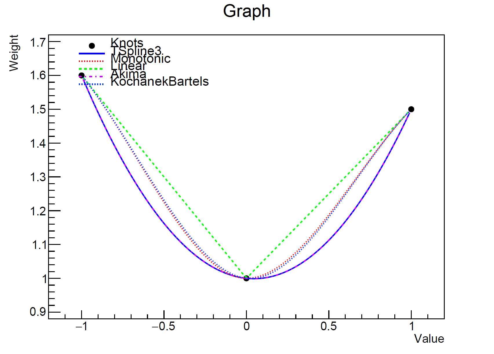
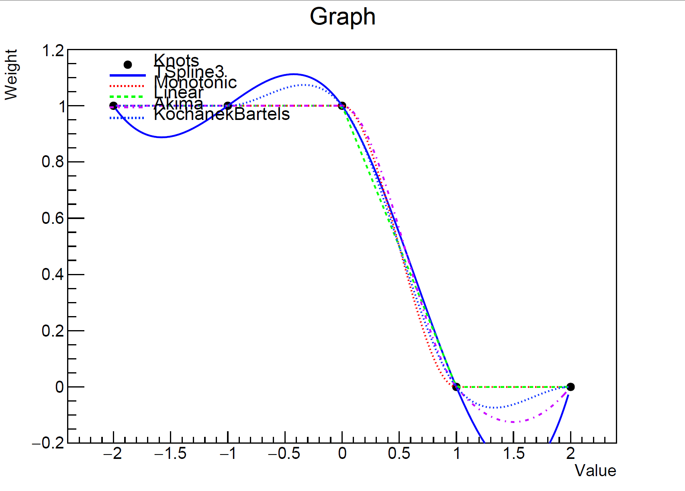
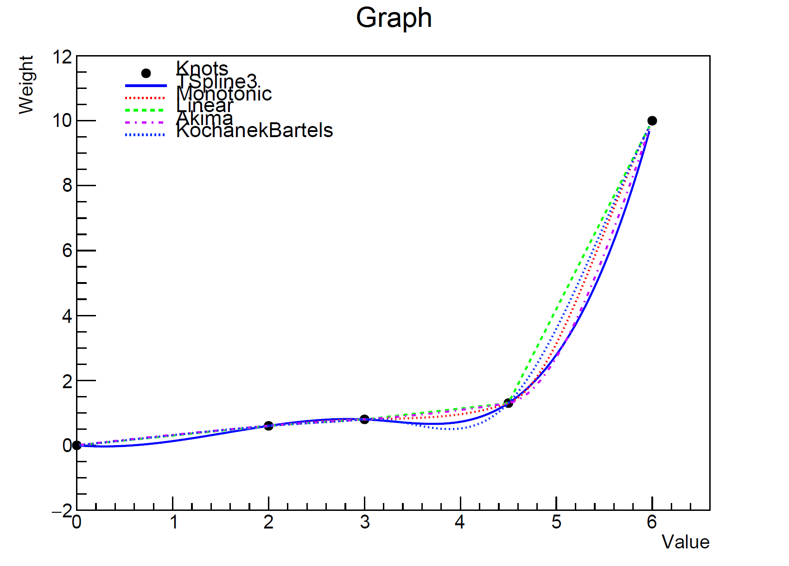
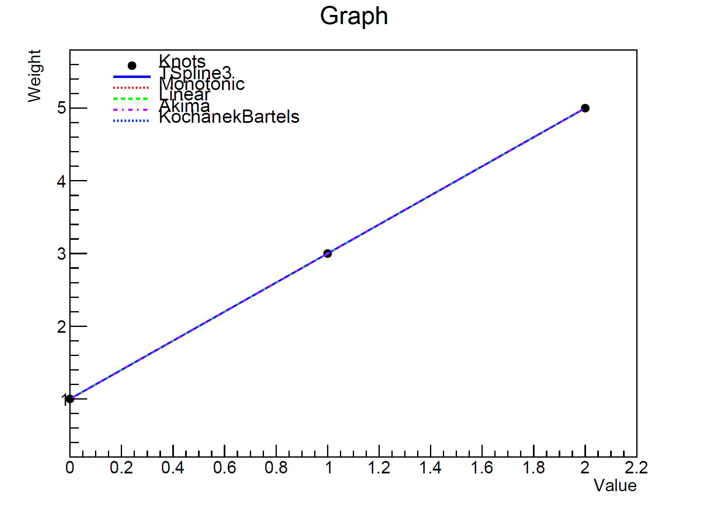
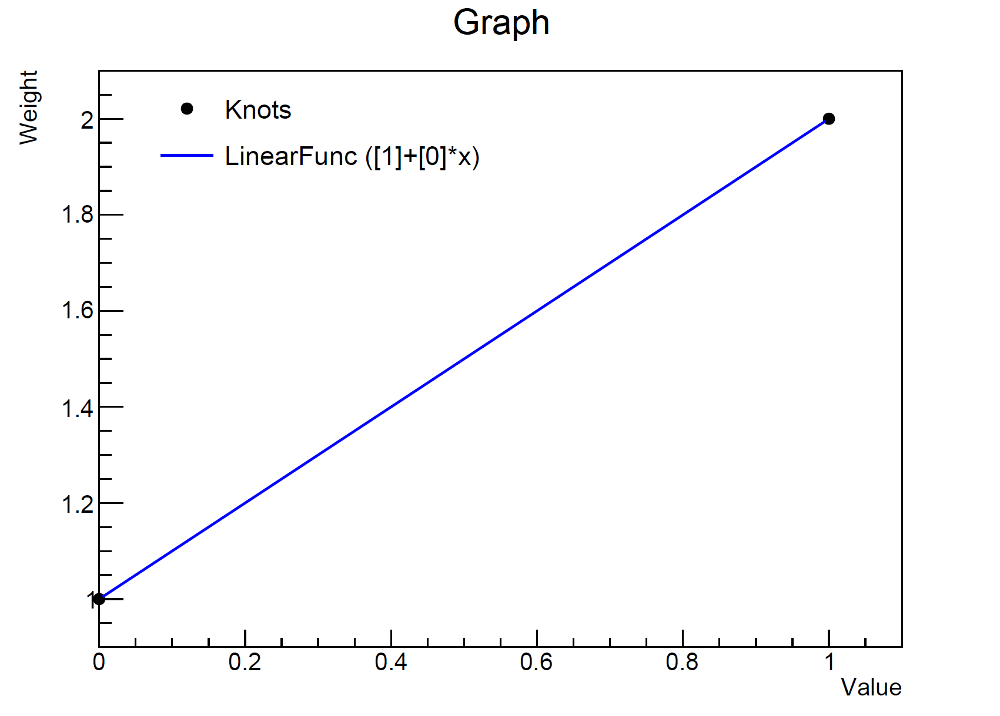
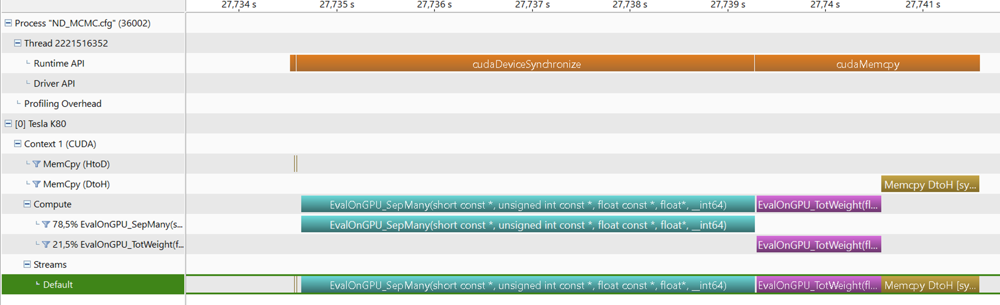

# Splines

## What is a spline?

MaCh3's {cpp:class}`SplineBase` interface is implemented by classes such as
{cpp:class}`BinnedSplineHandler`.
Spline, sometimes called response function, encodes dependence between parameter value and weight.
By having these complex responses precomputed, it allows evaluating weight during fit time very fast.

We usually store several points at which weight were evaluated, called knots.
Thus, we need to interpolate between points interpolation type is up to user
as MaCh3 has several options available.

## Spline Interpolation (3-rd order polynomials)
Default interpolation is kTSpline3. It follows ROOT TSpline3 implementation.

Above is the most common example of response function/spline for which all available options perform similarly.

However, there are examples where we want to enforce linear interpolation as this is the desired response.
Usually in situation when we reweight between different models. For this, recommended is kLinear.

Another often encountered case is where there are large differences between weight, resulting in so called ringing:

For such case-based options are kMonotonic which ensures spline segments are monotonic or kKochanekBartels.

## Linear Function
Since quite often we are using linear responses, it is generally recommended to reduce number of splines knots.
As more spline knots doesn't contribute to better response, but each knot affects RAM.

Another option is to use kLinearFunc which simple performs linear function (a*x+b) resulting in much better performance
and less RAM.

## Spline Extrapolation
For extrapolating beyond the limits of the spline we calculate the weight using the closest segment. This is essentially 'extending' the first segment below the first knot if extrapolating below the spline limits, or extending the last segment above the last knot if extrapolating above the limits. With linear function this simply uses the same coefficients as used for the rest of the spline.

### GPU
Since the calculation of event by event spline is quite often the bottleneck, there is GPU support for these calculations. From developer and user point of view, code works the same. If GPU support is enabled, MaCh3 will copy spline information to the GPU and perform calculations there.

